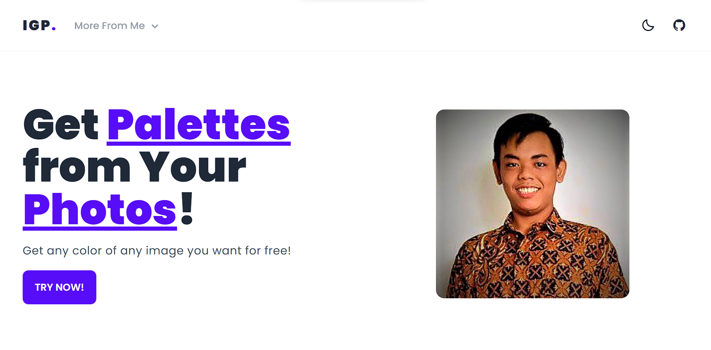

<p align="center">
   
</p>

<!-- Garis Lurus -->
 
<!-- End -->

<h1 align="center">IMAGE GET PALETTE</h1>
<!-- Garis Lurus -->
 
<!-- End -->


<!-- Garis Lurus -->
 
<!-- End -->

 ## ✅ About 
 > ### This website is a website for generating colors / palettes from inputted images.


<!-- Garis Lurus -->
 
<!-- End -->

## 👦🏽 Who created this application?

| Profile        |  Information                      |
|----------------|----------------------------------|
| Name           | Bagus Budi Satoto                |
| Major        | Bachelor of Informatics                |
| Campus         |  University Amikom  Yogyakarta    |

<!-- Garis Lurus -->
 
<!-- End -->

## 📊 Languages and Tools
<br>

- [HTML](https://developer.mozilla.org/en-US/docs/Web/HTML)

- [CSS](https://developer.mozilla.org/en-US/docs/Web/CSS)

- [Javascript](https://developer.mozilla.org/en-US/docs/Web/JavaScript)

- [Git](https://git-scm.com/)

- [vs-code](https://code.visualstudio.com/)


<!-- Garis Lurus -->
 
<!-- End -->

## 🔗 How to Install
<br>

- <code>git clone ↆↆ </code>
  
  ```bash
  git clone https://github.com/bagussatoto/image-get-palette.git
  ``` 
  
- <code>cd image-get-palette</code>
- <code>npm install</code>
- <code>npm run dev</code> (watch and rebuild the Tailwind CSS while editing)
- <code>npm run minify</code> (builds <code>src/js</code> into <code>dist/js</code> and the minified CSS, used by CI)
- <code>npm test</code> (runs unit tests)
- Edit JavaScript in <code>src/js/</code>; <code>dist/js/</code> is generated by <code>npm run minify</code> / <code>npm run dev</code>.
- Serve the folder with a local web server, for example <code>npx serve .</code>, then open the URL it prints.
  Do not open <code>index.html</code> directly via <code>file://</code>, because the browser blocks reading image pixels (CORS) and the palette cannot be generated.

<!-- Garis Lurus -->
 
<!-- End -->


##  🚫 Demo 
- 🚫 [Demo](https://imagetopalette.netlify.app/)


<!-- Garis Lurus -->
 
<!-- End -->


## 📌 New Feature Request and Bug Report

You can request new features or report bugs through the [**issues**](https://github.com/bagussatoto/image-get-palette/issues) menu provided by GitHub (see menu above), post new issues and we will discuss there. 

<!-- Garis Lurus -->
 
<!-- End -->

## 🛒 Contribute

Anyone can [contribute](https://github.com/bagussatoto/image-get-palette/blob/main/CONTRIBUTING.md) to this project from programming, opening a manual, to introducing this product to students
to learn to reduce the technology education gap by posting an issue in this repository.

<!-- Garis Lurus -->
 
<!-- End -->

> 🧑🏽‍💻 | [BAGUS BUDI SATOTO ](http://github.com/bagussatoto)
<br>

